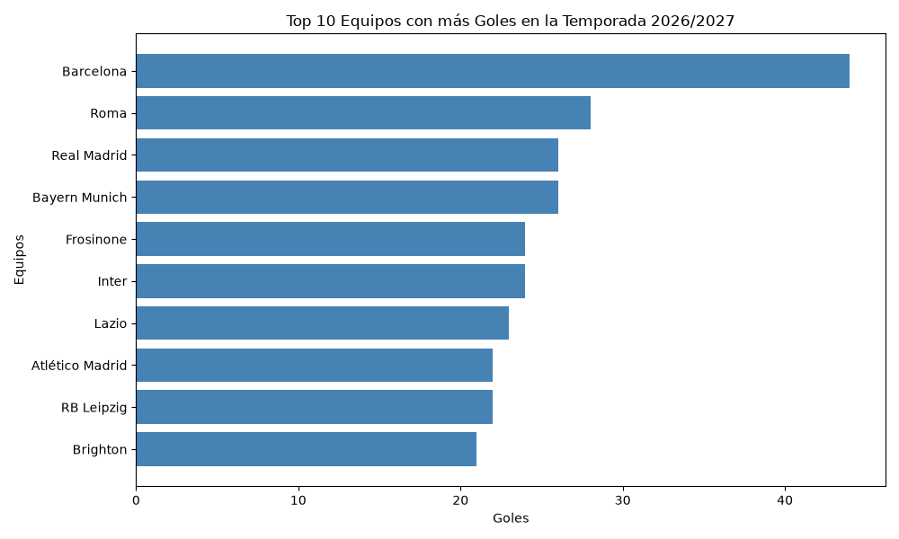

# ⚽ El Mapa del Peligro: Análisis de Ataque por Equipos

Este proyecto analiza la eficiencia ofensiva de los equipos de fútbol durante la temporada 2026/2027. El objetivo es identificar no solo qué equipos marcan más goles, sino cuáles son más eficientes (goles por tiro) y cuáles desperdician oportunidades.

*El dataset utilizado contiene estadísticas de jugadores de las principales ligas europeas (La Liga, Serie A, Premier League, Bundesliga, etc.), por lo que el análisis compara a los equipos de élite de todo el continente, no solo de una liga local.*

## 🛠️ Herramientas utilizadas
*   **Python** (Pandas para manipulación de datos)
*   **Matplotlib** (para visualización de datos)
*   **VS Code** y **Git** (control de versiones)

## 📊 Metodología
1.  **Carga de datos:** Se utilizó un dataset de FBref con estadísticas de jugadores.
2.  **Agrupación:** Se agruparon los datos por equipo (`Squad`) sumando goles (`Gls`), tiros (`Sh`), tiros a puerta (`SoT`) y asistencias (`Ast`).
3.  **Métrica de Eficiencia:** Se creó la columna `Efectividad_Tiro` calculando `Goles / Tiros Totales`.
4.  **Visualización:** Se generó un gráfico de barras horizontal con el Top 10 de equipos más goleadores.

*Nota metodológica: Los datos analizados corresponden a la fecha de descarga del dataset (Noviembre de 2026). Al ser una temporada en curso, las métricas son parciales y pueden variar a medida que avancen las jornadas.*

## 📈 Resultados Principales

*   **El poderío del Barcelona:** El FC Barcelona lidera la tabla de goles con una diferencia notable sobre el segundo lugar, consolidándose como la ofensiva más letal del dataset.
*   **La sorpresa de la Roma:** En un contexto donde los gigantes europeos suelen dominar, la Roma se posiciona en un sorprendente segundo lugar en goles anotados, demostrando una gran capacidad ofensiva en esta temporada.
*   **El Real Madrid en el podio:** El conjunto merengue cierra el Top 3, confirmando su habitual presencia en las posiciones de élite ofensiva.
*   **El caso del Brighton:** Aunque cierra el Top 10 de nuestra lista, el Brighton se codea con equipos de la talla de Bayern Munich, Inter o Atlético de Madrid, lo que refleja una gran competitividad y un nivel de ataque destacable.
*   **Una temporada reñida:** A partir del tercer puesto, las diferencias en goles son mínimas (entre 27 y 21 goles), mostrando una competencia muy equilibrada entre los equipos de élite europea.

## 🖼️ Visualización

## 📂 Fuentes y Datos
Los datos utilizados en este proyecto fueron obtenidos del dataset **'Football Players Stats (2026-2027)'** disponible en Kaggle bajo licencia MIT. La fuente original de las estadísticas es **FBref (Sports Reference)**.

## 🚀 Cómo ejecutar este proyecto
1. Clona este repositorio.
2. Instala las dependencias: `pip install pandas matplotlib`
3. Ejecuta el script: `python src/analisis_equipos.py`

---
*Análisis realizado por Daniela Jimenez como parte de mi portafolio de análisis de datos deportivos.*
*10 de noviembre de 2026*